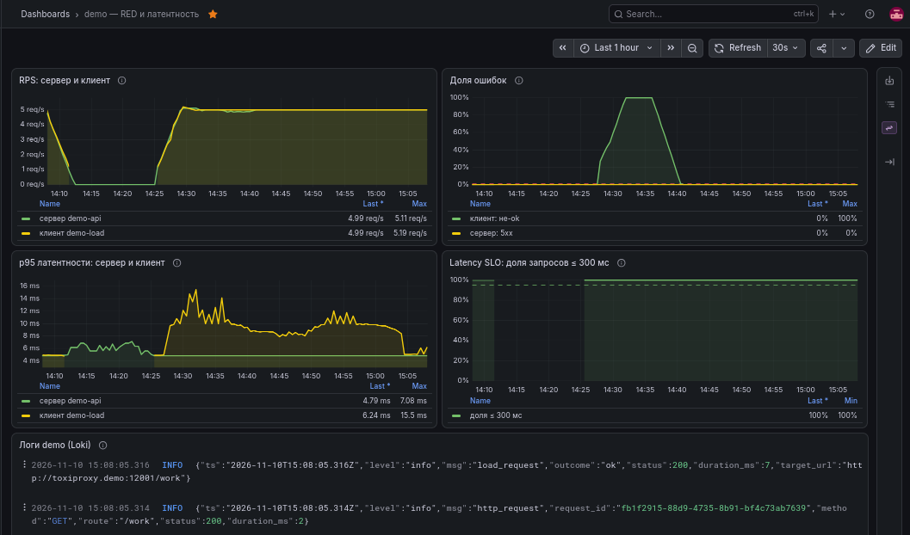
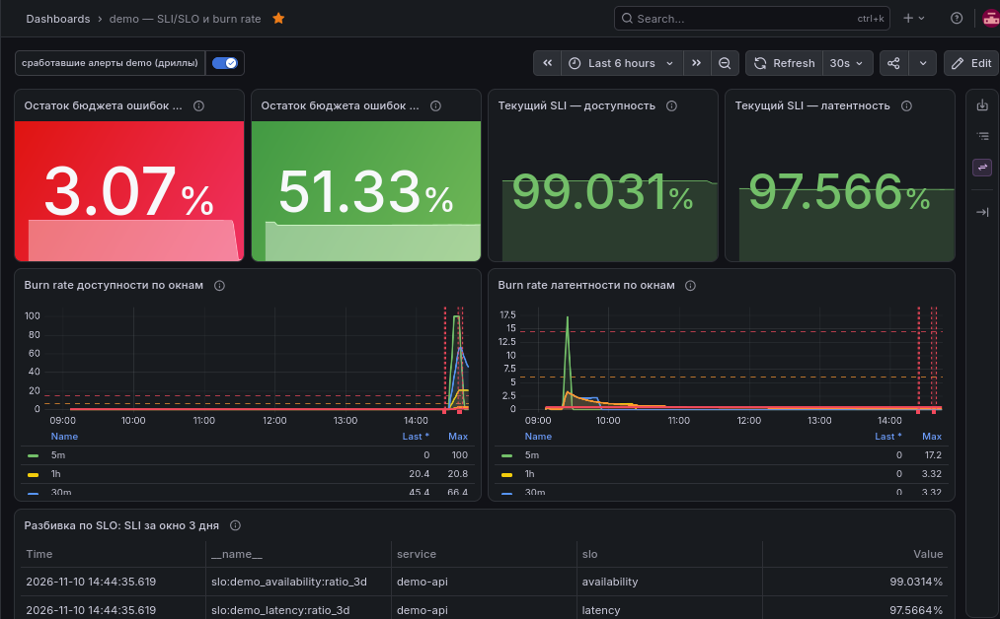
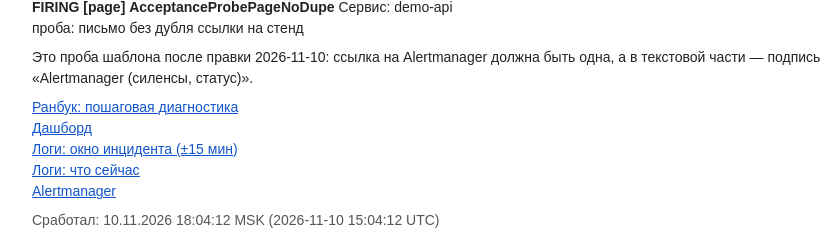
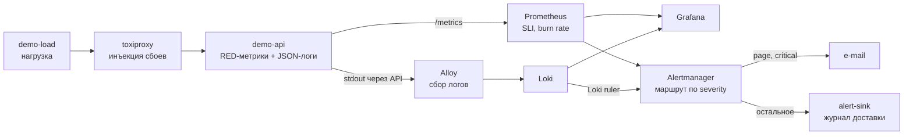

# k8s-observability-lab

[](https://github.com/morgenvor/k8s-observability-lab/actions/workflows/ci.yml)

**Мониторинг, который доказывает, что работает.**

Пет-проект про эксплуатацию на Kubernetes: SLO, посчитанные по опыту клиента; алерты,
которые действительно доходят до человека; логи, привязанные к инциденту; и
инцидент-дриллы, у которых есть машинночитаемые доказательства.

Большинство мониторинговых стендов показывают, что метрики собираются. Этот проект
отвечает на другой вопрос: **сработает ли алерт, дойдёт ли он до получателя и
подтвердится ли восстановление — и чем именно это доказано.**

В текущей версии — 27 алертов и 20 записывающих правил, три дашборда и четыре
инцидент-дрилла с машинночитаемыми доказательствами.

## Что умеет проект

### SLO считаются по тому, что видит клиент

Нагрузка идёт через Toxiproxy, а исход и латентность меряет клиент — так же, как это
делал бы реальный пользователь. Prometheus записывает SLI и burn rate по нескольким
окнам, а алерты используют классическую мультиоконную схему: быстрый `page` требует
превышения порога и в коротком, и в длинном окне, поэтому реагирует на реальный расход
бюджета, а не на минутный всплеск.

### Алерт — это доставка, а не «firing»

Уведомления маршрутизируются по `severity`: `page` и `critical` уходят письмом,
остальное — в webhook-приёмник, который хранит журнал доставленных событий. Явный
catch-all не даёт неизвестному `severity` исчезнуть молча. Алерты о поломке самого
пути уведомлений (`AlertSink.*`) дополнительно уходят письмом, чтобы сигнал не умер
вместе с приёмником. Отдельные heartbeat-правила следят за самим путём уведомлений:
если маршрут замолчал, об этом узнают раньше, чем закончится инцидент.

### Логи — второй класс проверки

Loki собирает stdout подов через Alloy, Grafana показывает логи рядом с метриками, а
правило Loki ruler умеет поднимать алерт по содержимому логов. В уведомление
`page`-алерта SLO попадают ссылки на runbook, дашборд и логи ровно того окна, в
котором случился инцидент.

### Дриллы вместо обещаний

Четыре сценария — ошибки, задержка, OOM и сломанная readiness-проба — запускаются на
живом стенде и заканчиваются JSON-доказательством: таймлайн событий, время реакции,
факт `firing`/`resolved` и подтверждение доставки уведомления в приёмник. Если алерт не
дошёл, дрилл считается провальным, даже если Prometheus его видел.

### Ворота качества

Перед каждым изменением работает один набор проверок: линтеры, юнит-тесты сервисов,
рендер чартов с проверкой схем, `promtool check/test rules`, проверка ссылок и шаблона
письма, сканы секретов и адресов. Те же ворота запускаются в CI. Правила, маршрут и
дашборды проверяются не «на глаз», а ассертами, у которых есть самопроверки.

## Как это выглядит

Скриншоты сняты на живом стенде; кадр `demo-red` — сразу после дрилла `errors`, на нём
виден всплеск ошибок, восстановление и расход бюджета SLO.



*RPS, доля ошибок, p95 и latency SLO глазами клиента и сервера; внизу — живые логи
namespace из Loki.*



*Остаток бюджета, текущий SLI за три дня, burn rate по окнам и разбивка по SLO.*



*Письмо по `page`-алерту: статус, severity, ссылки на runbook, дашборд, логи и
Alertmanager, время в MSK и UTC. Кадр снят на учебной пробе.*

## Как это устроено



| Слой | Чем |
|---|---|
| Оркестрация | k3s |
| Метрики и алерты | Prometheus, Alertmanager (kube-prometheus-stack) |
| Визуализация | Grafana |
| Логи | Loki + Grafana Alloy |
| Инъекция сбоев | Toxiproxy |
| Демо-сервисы | Node.js: `demo-api`, `demo-load`, `alert-sink` |
| Доставка | Helmfile и Kustomize |
| Проверки | GitHub Actions и собственные ассерты проекта |

## Кому полезно

- SRE и DevOps-инженерам, которым нужен рабочий пример SLO-алертинга и маршрута
  уведомлений, а не набор YAML без проверок;
- тем, кто готовит портфолио: здесь есть воспроизводимые доказательства, а не
  утверждение «настроено и работает»;
- командам, которым нужен переносимый шаблон дриллов и разбора инцидентов.

## Быстрый старт

Кластер не нужен, чтобы увидеть, как проект проверяет сам себя. Нужны `git`, `python3`
с PyYAML и `npm`; для `--smoke` — ещё `docker`.

```bash
git clone https://github.com/morgenvor/k8s-observability-lab.git
cd k8s-observability-lab
./scripts/bootstrap-tools.sh   # kubectl, helm, helmfile, kubeconform, promtool, alloy
./scripts/check.sh             # линтеры, тесты, рендер, promtool, сканы
```

`./scripts/check.sh --smoke` дополнительно собирает образы и запускает сервисы в docker.
Живой стенд, деплой, откат и диагностика — в [runbook](docs/runbook.md).

## Документация

| Файл | О чём |
|---|---|
| [docs/runbook.md](docs/runbook.md) | процедуры: инструменты, образы, deploy/rollback, UI, логи, маршрут уведомлений, реакция на алерты |
| [docs/drills.md](docs/drills.md) | четыре дрилла: что инъецируется, что должен увидеть пользователь, схема evidence |
| [docs/verification.md](docs/verification.md) | что и чем проверено: дата, команда, результат; чего живьём ещё нет |
| [evidence/](evidence/) | JSON-доказательства дриллов и транскрипты прогонов |

## Честные границы

- Стенд — две ноды k3s в домашней лабе: registry нет, TLS нет; Prometheus и
  Alertmanager открыты без аутентификации, Grafana — с логином. Это осознанные
  ограничения лаборатории, а не недосмотр.
- Часть сценариев пока подтверждена только `promtool`, а не живьём: slow-burn алерт
  требует трёх суток данных, heartbeat-тишина — 5,5 часов, падение вычисления Loki
  ruler и настоящий 5xx в логах требуют отдельных инъекций. Полный список — в
  [docs/verification.md](docs/verification.md).
- E-mail-ветка зависит от SMTP-egress стенда: при закрытом порту письма не уходят,
  хотя конфигурация остаётся валидной.

Если нужен стенд, который не боится сбоев и умеет это доказывать, — начните с
[runbook](docs/runbook.md) и [дриллов](docs/drills.md).