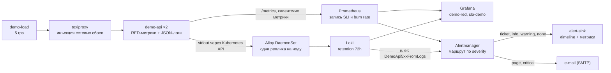
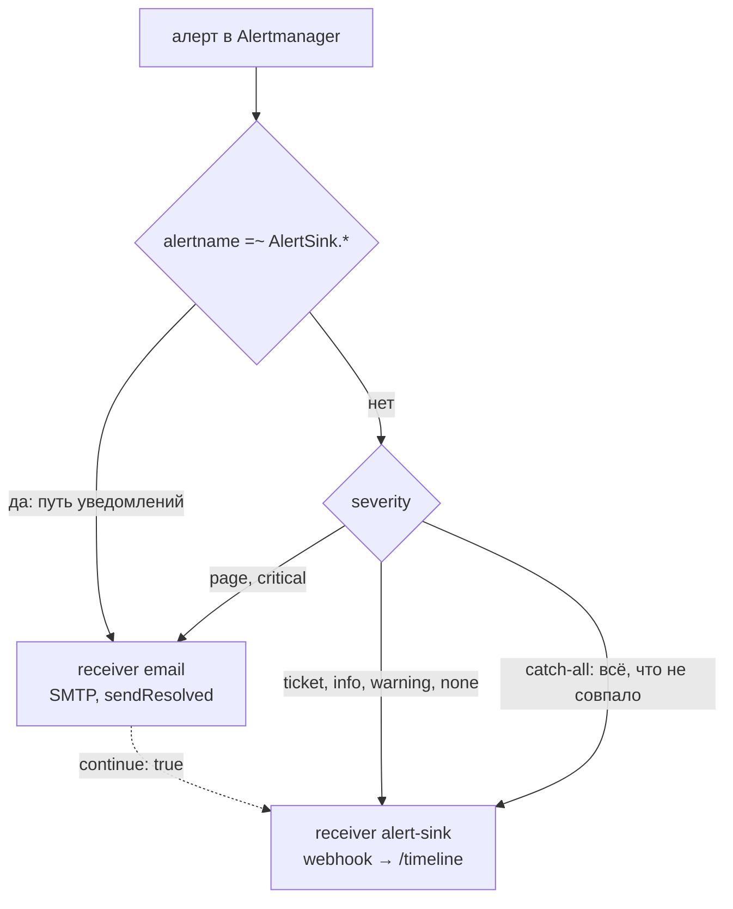

# k8s-observability-lab

Pet-проект про эксплуатацию: SLI/SLO с burn-rate алертами, качество алертов, логи и
инцидент-дриллы. Стенд — k3s из двух нод в домашней лабе; сбои в нём инъецируются
намеренно, а каждое утверждение проверяется дриллом или офлайн-воротами, а не «настроено,
значит работает».

Что проект доказывает:

- **SLO считаются по тому, что видит клиент**, а не по метрикам сервера: нагрузка идёт
  через toxiproxy, клиент меряет исход и латентность, Prometheus пишет SLI и burn rate;
- **алерт доходит до человека**: вебхук-приёмник хранит `/timeline` доставленных
  уведомлений, а маршрут делит поток по `severity` (e-mail для `page`/`critical`,
  приёмник для остального) — и путь уведомлений сам под наблюдением;
- **логи — рабочий инструмент, а не галочка**: Loki + Alloy с фильтром по ноде, панель
  логов в дашборде, алерт на пайплайн логов и правило по логам в Loki ruler
  (`DemoApi5xxFromLogs`) — второй класс проверки рядом с метриками;
- **дриллы с доказательствами**: `evidence/*.json` со схемой `drill-evidence/v1` содержат
  время реакции, факт `firing`/`resolved` и доставку уведомления в приёмник.

## Поток данных



## Маршрут алертов



Схема соответствует конфигу `deploy/monitoring/alertmanagerconfig.yaml`. Ветка
`alertname=~"AlertSink.*"` стоит первой и ведёт в `email` с `continue: true`: алерты
самого пути уведомлений (`rules/notifications.yaml`) имеют `severity: ticket`, и без
неё сигнал «маршрут до sink сломан» уходил бы только в сломанный sink. Дальше `page` и
`critical` уходят в `email`, остальные `severity` — в `alert-sink`, а catch-all без
матчеров страхует неизвестный `severity`. Адреса и SMTP-хост в git — плейсхолдеры
`example.invalid`: реальные значения подставляет окружение при деплое
(`ALERT_EMAIL_TO`/`ALERT_EMAIL_FROM`/`SMTP_SMARTHOST`/`SMTP_USERNAME`), иначе письма не
уходят. Доставка webhook подтверждена живьём (`/timeline`, метрика `alertsink_*`); по e-mail
подтверждена отправка (`notifications_total{integration="email"}` растёт,
`failed_total` = 0), а вручение письма в ящик проверяет владелец — это записано в
`docs/verification.md`.

Почему ветка `email` стоит рядом с явным catch-all: у наших правил `severity ∈
{page, ticket, info}`, у правил чарта — `critical`/`warning`, у `Watchdog` — `none`.
Маршрут без явной ветки-страховки отправил бы несовпавший алерт в `null`-приёмник, и он
исчез бы молча.

## Состав и версии

| Компонент | Версия | Где закреплено |
|---|---|---|
| k3s (стенд) | v1.37.1+k3s1 | вне репозитория |
| kube-prometheus-stack (chart) | 92.14.1 | `helmfile.yaml` |
| Prometheus | v3.15.1 | чарт |
| Alertmanager | v0.34.1 | чарт |
| Prometheus Operator | v0.94.2 | чарт |
| Grafana | 13.2.4 | чарт |
| node-exporter / kube-state-metrics | v1.12.1 / v2.20.0 | чарт |
| Loki (chart / image) | 7.5.0 / 3.6.11 | `helmfile.yaml`, `helm/values/loki.yaml` |
| Alloy (chart / image) | 1.15.0 / v1.21.3 | `helmfile.yaml`, `helm/values/alloy.yaml` |
| toxiproxy | 2.9.0 | `deploy/base/toxiproxy.yaml` |
| demo-api, demo-load, alert-sink | node:22.23.4-alpine, тег = короткий SHA | `app/*/Dockerfile` |

Своё: 23 алерта и 20 записывающих правил (43 правила) в 6 `PrometheusRule` (10 групп)
плюс одно правило Loki ruler (`deploy/loki-rules`), два дашборда (`demo-red`, `slo-demo`),
четыре дрилла, офлайн-ворота `./scripts/check.sh` (их же запускает CI).

## Быстрый старт

```bash
./scripts/bootstrap-tools.sh     # helm, helmfile, kubectl, kubeconform, promtool, helm-diff в .tools/
./scripts/check.sh               # офлайн-проверки: линтеры, тесты, рендер, promtool, скан секретов
export KUBECONFIG=/путь/к/своему/kubeconfig   # или .secrets/kubeconfig рядом с проектом
./scripts/build-image.sh         # образы приложений с тегом = короткий SHA
./scripts/import-image.sh        # импорт в containerd каждой ноды (registry в лабе нет)
./scripts/deploy.sh              # демо-контур, правила, дашборды, маршрут уведомлений
```

Порядок и предпосылки подробно — `docs/runbook.md`. Там же: свой стенд, свои host'ы,
что меняется при переносе на кластер с registry.

## Документы

| Файл | О чём |
|---|---|
| `docs/runbook.md` | процедуры: инструменты, образы, deploy/rollback, UI, логи, маршрут уведомлений, реакция на алерты |
| `docs/drills.md` | дриллы: что инъецируется, что должен увидеть пользователь, схема evidence |
| `docs/verification.md` | что и чем проверено: дата, команда, результат (без адресов лабы) |
| `docs/publish.md` | действия владельца по публикации: поля репозитория, branch protection, тег |
| `evidence/` | JSON-доказательства дриллов и транскрипты прогонов |

## Скриншоты

| Дашборд | Файл |
|---|---|
| `demo — RED и латентность` | `docs/images/demo-red.png` |
| `demo — SLI/SLO и burn rate` | `docs/images/slo-demo.png` |
| Письмо по `page`-алерту | `docs/images/alert-email.png` |

## Что проверено и ограничения

Проверки делятся на два класса: **офлайн-ворота** (`./scripts/check.sh`, те же в CI —
линтеры, тесты приложений, рендер чартов с ассертами, `promtool check/test rules`, скан
секретов) и **живые проверки** на стенде (дриллы, доставка уведомлений, UI). Факты с
датами, командами и числами — в `docs/verification.md`; там же отдельным списком то, что
живьём ещё не подтверждено.

Ограничения, которые не являются недосмотром:

- **registry нет**: образы только в containerd нод, тег = короткий git SHA; ноды не тянут
  крупные образы из docker.io, поэтому сторонние образы импортируются тем же путём;
- **аутентификации и TLS у UI нет** — стенд изолирован, это осознанный выбор лабы;
- **кнопка «Silence» в UI Prometheus** ведёт на pod IP Alertmanager (`/api/v1/alertmanagers`
  строится из адреса цели) — силенсы создаются в UI Alertmanager; relabeling адреса сломал
  бы фактическую доставку через Service;
- **slow-burn алерт (1x / 3d)** живьём не проверен: нужны трое суток непрерывных данных,
  окно лабы короче. Логика покрыта `promtool test rules`;
- **позиции чтения Alloy** лежат в `emptyDir`: после пересоздания пода логи
  контейнера читаются с начала, поэтому строки старше 50 минут отбрасываются на
  стороне Alloy (`loki.process` → `stage.drop`, счётчик
  `loki_process_dropped_lines_total{reason="too_old"}`). Порог выведен из окна
  приёма Loki (`max-chunk-age/2` = 1 ч при дефолтах), поэтому занимает не всё окно;
  потерь и дублей на живых данных отдельно не измеряли;
- **e-mail-ветка зависит от SMTP-egress** стенда: при закрытом порту письма не уходят,
  конфиг при этом остаётся валидным (и `deploy.sh` останавливается, если деплой без
  e-mail-переменных затёр бы живые адреса плейсхолдерами);
- домен `*.lab.internal` — **намеренный плейсхолдер**, реальных имён стенда в репозитории
  нет; свои имена задаются в `helm/values/kps.yaml` и `/etc/hosts`.