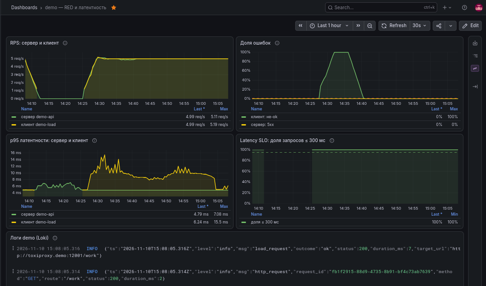
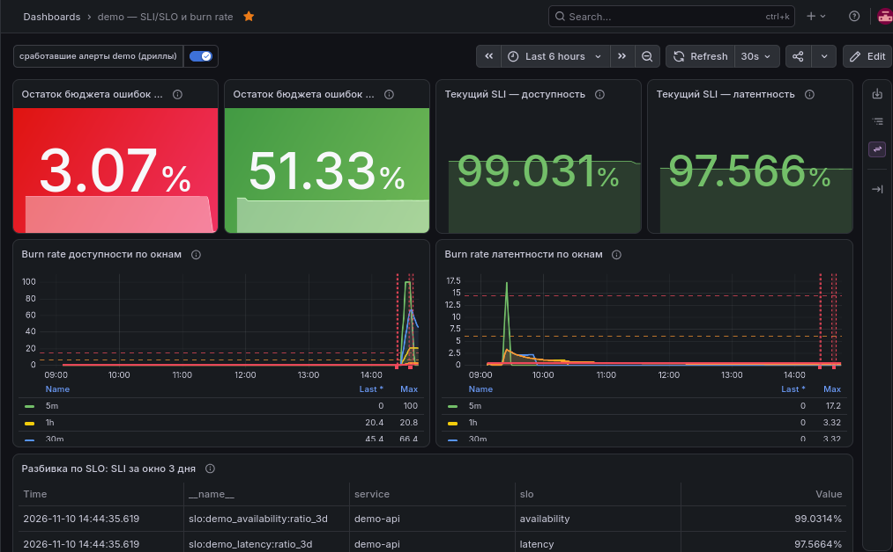
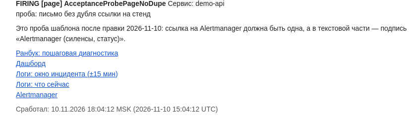

# k8s-observability-lab

[](https://github.com/morgenvor/k8s-observability-lab/actions/workflows/ci.yml)

**Русский** | [English](README.md)

**Мониторинг, который доказывает, что работает.**

Пет-проект про эксплуатацию сервиса на Kubernetes: SLO, посчитанные по опыту клиента;
алерты, которые действительно доходят до получателя; логи, привязанные к окну
инцидента; и инцидент-дриллы, у которых есть машинночитаемые доказательства.

Большинство мониторинговых стендов показывают, что метрики собираются. Этот проект
отвечает на другой вопрос: **сработает ли алерт, дойдёт ли он до получателя и
подтвердится ли восстановление — и чем именно это доказано.**

`k3s` · `Prometheus` · `Alertmanager` · `Grafana` · `Loki` · `Grafana Alloy` ·
`Toxiproxy` · `Node.js` · `Helmfile` · `Kustomize` · `GitHub Actions`

> **Состояние: v1.1.** Шесть объектов `PrometheusRule`, 11 групп, 49 правил (29 алертов:
> 25 `ticket`, 4 `page`; ещё 20 записывающих), одно правило Loki ruler, три дашборда и
> четыре дрилла. Офлайн-ворота не требуют кластера, а у каждого живого утверждения в
> [docs/verification.md](docs/verification.md) есть дата и границы. Runbook, отчёты
> дриллов и письмо алерта — на русском.

## Что это доказывает

- **SLO считаются по стороне клиента.** Нагрузка идёт через Toxiproxy, а исход
  фиксирует клиент, поэтому задержка и обрывы, добавленные на прокси, видны ровно так,
  как их почувствовал бы пользователь; собственные метрики сервиса их не видят.
  Доступность — 99 %, латентность (доля запросов быстрее 300 мс) — 95 %, окно — трое
  суток.
- **Алерт — это доставка, а не состояние `firing`.** Маршрут построен по `severity`:
  `page` и `critical` уходят письмом, остальное — в webhook-приёмник, который ведёт
  журнал. Ветка почты не исключает приёмник, ветка `AlertSink.*` вычисляется первой с
  `continue: true`, а явный catch-all не даёт неизвестному `severity` исчезнуть молча.
- **Логи — второй класс доказательств.** Loki собирает stdout подов через Alloy,
  Grafana показывает логи рядом с метриками, а одно правило Loki ruler поднимает алерт
  по содержимому логов. Письмо `page`-алерта содержит ссылки на runbook, дашборд и
  логи ровно того окна, в котором случился инцидент (±15 минут).
- **Дриллы вместо обещаний.** Четыре сценария прогоняются на живом стенде и пишут
  JSON-таймлайн: события, время реакции, `firing`/`resolved` и подтверждение доставки
  в приёмник. Если алерт сработал, но не дошёл, дрилл считается провальным.
- **Ворота падают на дрейфе.** Одна команда запускает линтеры, тесты приложений,
  рендер чартов с проверкой схем, `promtool check/test rules`, проверку ссылок и
  шаблона письма, сканы секретов и адресов. Утверждения проверяют себя мутациями, и те
  же ворота идут в CI.

## Как это устроено

Всё работает на двух нодах k3s в двух namespace, `demo` и `monitoring`: демо-сервисы и
приёмник алертов в первом, стек мониторинга и маршрут уведомлений — во втором.

<p align="center">
  
</p>

| Слой | Чем |
|---|---|
| Оркестрация | k3s, две ноды, Traefik ingress встроен |
| Метрики и алерты | Prometheus и Alertmanager из kube-prometheus-stack `92.14.1` |
| Визуализация | Grafana, три дашборда из ConfigMap |
| Логи | Loki `3.6.11` (single binary, PVC 5 GiB) и Grafana Alloy `1.21.3` как DaemonSet |
| Инъекция сбоев | Toxiproxy между генератором и сервисом |
| Демо-сервисы | Node.js: `demo-api`, `demo-load`, `alert-sink` |
| Доставка | Helmfile для сторонних чартов, Kustomize для своих манифестов |
| Проверки | GitHub Actions и собственные ассерты проекта |

`demo-load` держит 5 rps через `toxiproxy`; `demo-api` отвечает на `/work`, отдаёт
`/metrics` и пишет одну JSON-строку на запрос. Prometheus записывает 20 серий SLI и burn
rate, Alloy читает логи подов через Kubernetes API (без hostPath и root) и пишет их в
Loki, Grafana читает оба хранилища. Алерты идут в Alertmanager, который маршрутизирует
их так, как описано ниже. Приёмник находится внутри контура: его stdout собирается как
у любого пода, а метрики скребутся как у любого приложения.

Четыре решения определяют числа, и ни одно из них не видно из одного YAML:

- **Только `page` и `ticket`.** В чарте есть `InfoInhibitor`, который глушит любой
  одиночный `info`-алерт в namespace, поэтому `info`-правило выглядело бы здоровым,
  молча. Все свои правила — `page` или `ticket`, а правила, которые кажутся
  информационными, намеренно `ticket`.
- **Alloy выбрасывает строки старше 50 минут** перед записью в Loki: после рестарта пода
  логи перечитываются с начала, а Loki отвергает чанки старше часа. Потери считаются в
  `AlloyDroppedLogs` и `AlloyOldLogsDropped`, а не исчезают.
- **В шаблонах Alertmanager нет арифметики.** Ссылка на логи собирается из
  `time` + `time.window`, потому что `toDuration` в движке шаблонов не существует;
  поэтому окно инцидента ±15 минут считает Grafana.
- **`up == 0` и `absent(up)` — разные правила.** Цель, которая перестала отвечать, и
  цель, которую вообще не обнаружили, — разные отказы с разными действиями.

## Маршрут алерта

<p align="center">
  
</p>

| # | Матчер | Получатель | Почему так |
|---|---|---|---|
| 1 | `alertname =~ "AlertSink.*"` | e-mail | вычисляется первой с `continue: true`: сигнал о поломке маршрута не должен идти только через сломанный маршрут |
| 2 | `severity =~ "page\|critical"` | e-mail | `continue: true`, поэтому событие получает и приёмник — два получателя для разных целей, а не дубль |
| 3 | `severity =~ "ticket\|info\|warning\|none"` | alert-sink | журнал для рабочего времени: `/timeline` и метрики `alertsink_*` |
| 4 | *без матчеров* | alert-sink | catch-all: новый, с опечаткой или отсутствующий `severity` не уйдёт в null-получатель |

За самим путём следят три правила `ticket`, потому что у чарта нет сигнала на его
тишину: маршрут молчит 5,5 часа, приёмник жив, но не получил ни одного события, и цель
скрейпа приёмника пропала. Ещё два правила сторожат сами группы: `AlertPathRulesAbsent`
и `LogsPipelineRulesAbsent` срабатывают, если их группы правил исчезли — неприменённое
правило или снятая метка `release` иначе выглядят как «проблем нет».

Доставка проверяется и при деплое: `scripts/deploy.sh` рендерит оверлей с реальными
адресами и не применяет заглушки `example.invalid` поверх живых адресов без явного
разрешения, а ещё сверяет в активной конфигурации Alertmanager всё дерево маршрутов —
адреса без дерева — это только половина правды.

## Как это выглядит

Скриншоты сняты на живом стенде. Кадр `demo-red` — в пределах часа после дрилла
`errors`: на нём видны всплеск ошибок, восстановление и латентность SLO, бюджет ошибок —
на втором кадре.



*RPS, доля ошибок, p95 и latency SLO глазами клиента и сервера; внизу — живые логи
namespace из Loki.*



*Остаток бюджета ошибок, текущий SLI за три дня, burn rate по окнам и разбивка по SLO.*



*Письмо по `page`-алерту: статус, severity, ссылки на runbook, дашборд, логи окна
инцидента и Alertmanager, время в MSK и UTC. Кадр снят на учебной пробе.*

## Быстрый старт

Кластер не нужен, чтобы увидеть, как проект проверяет сам себя. Нужны `git`, `python3`
с PyYAML и `npm`; для `--smoke` — ещё Docker.

```bash
git clone https://github.com/morgenvor/k8s-observability-lab.git
cd k8s-observability-lab
./scripts/bootstrap-tools.sh   # kubectl, helm, helmfile, kubeconform, promtool, alloy
./scripts/check.sh --strict    # линтеры, тесты, рендер, promtool, сканы
```

`./scripts/check.sh --smoke` дополнительно собирает образы и запускает три сервиса в
Docker. Живой стенд, деплой, откат и диагностика — в [runbook](docs/runbook.md).

## Ворота качества

`./scripts/check.sh` — единственный набор офлайн-ворот, и это тот же джоб, что идёт в CI
(`ci.yml`, с `--strict --smoke`). Что именно он проверяет:

- оба пути рендера — релизы Helmfile и ресурсы Kustomize — с валидацией
  `kubeconform` и смысловыми утверждениями про Loki, Alloy, ingress и PVC;
- маршрут алертов как дерево, связку `AlertmanagerConfig`, путь Loki ruler и размещение
  правил (метки, namespace, членство в kustomization);
- `promtool check rules` и `promtool test rules`: пять наборов фикстур, у каждого из
  29 алертов есть срабатывающий кейс, а кейсы medium/slow проверяют, что срабатывает
  ровно один алерт;
- шаблон письма, отрендеренный stdlib-движком Go с воссозданным `FuncMap` Alertmanager:
  обязательные поля, окно инцидента, ровно одна ссылка на стенд;
- дашборды: валидность JSON, запросы панелей сверяются с исходниками приложений и
  записывающими правилами, а сами проверки ловят свои ошибки мутациями;
- селекторы ServiceMonitor, паритет оверлея деплоя, `shellcheck`, тесты сигналов
  дриллов, сканы секретов и личных адресов (все совпадения —
  `example.invalid`/`example.com`).

Чего ворота не делают: они не видят скриншоты, не доказывают, что уведомление дошло до
почтового ящика, а под `--strict` любой пропущенный шаг — провал, а не молчаливый
успех.

## Дриллы и доказательства

| Дрилл | Инъекция | Ожидаемый сигнал | Измеренная реакция |
|---|---|---|---|
| `errors` | `reset_peer` на прокси Toxiproxy: рвётся каждое соединение | доступность падает до нуля, `SloDemoAvailabilityBurnFast` (`page`) | 11,5 мин до `page` |
| `latency` | задержка 400 ± 50 мс на прокси | p95 выше 300 мс, при этом запросы успешны; `SloDemoLatencyBurnFast` (`page`) | 26 мин до `page` |
| `readiness` | readiness-проба указывает на `/nope`, поды пересоздаются | ноль готовых endpoints, `page` по доступности | 19,3 мин до `page` |
| `oomkill` | запись 200 MiB внутри контейнера с лимитом `192Mi` | `KubePodOOMKilled` (`ticket`) и событие в `/timeline` | 102 с |

Каждый прогон пишет `evidence/<дата>-<дрилл>.json` в схеме `drill-evidence/v1` и
транскрипт в консоли. Повторный прогон не затирает доказательства: прошлый файл сначала
уезжает в `evidence/attempts/` с суффиксом `-attemptN`. Сценарии, предусловия и откат
описаны в [docs/drills.md](docs/drills.md).

## Структура репозитория

| Путь | Назначение |
|---|---|
| [`helmfile.yaml`](helmfile.yaml), [`helm/values/`](helm/values) | сторонние чарты с пинами версий и значения проекта |
| [`kustomization.yaml`](kustomization.yaml), [`deploy/`](deploy) | свои манифесты: приложения, Toxiproxy, ServiceMonitor, дашборды, правила Loki, `AlertmanagerConfig` |
| [`rules/`](rules) | шесть объектов `PrometheusRule` и фикстуры `promtool` в [`rules/tests/`](rules/tests) |
| [`app/`](app) | `demo-api`, `demo-load`, `alert-sink` — Node.js с юнит-тестами |
| [`drills/`](drills), [`evidence/`](evidence) | четыре дрилла с общей библиотекой и их JSON-транскрипты |
| [`scripts/`](scripts) | `check.sh` с ассертами в `scripts/checks/`, а также bootstrap, deploy, rollback, импорт образов и smoke |
| [`docs/`](docs) | runbook, дриллы, verification и SVG-схемы, которые используются выше |
| [`.github/workflows/ci.yml`](.github/workflows/ci.yml) | офлайн-ворота в CI |

## Чего живьём ещё нет

- **Только офлайн:** slow-burn алерт (1x за трое суток), 5,5 часа тишины маршрута,
  падение вычисления ruler и настоящий 5xx в логах `demo-api` — единственный источник
  5xx это `/ready` при дренаже, и правило исключает его намеренно. Сторож пропавшей цели
  скрейпа подтверждён живьём 2026-11-10; два оставшихся heartbeat-правила покрыты только
  тестами `promtool`.
- **Стенд — не продакшен.** Registry нет (образы импортируются на каждую ноду и
  тегируются коротким SHA коммита), TLS нет, Prometheus и Alertmanager открыты без
  аутентификации, Grafana требует логин, а хосты UI — плейсхолдеры `*.lab.internal`,
  которые нужно прописать в `/etc/hosts`.
- **E-mail зависит от SMTP-egress.** Если порт закрыт, конфигурация остаётся валидной, а
  письмо просто не уходит со стенда.
- **Скриншоты воротами не проверяются.** Они сняты на живом стенде, а кадр письма — это
  учебная проба, а не инцидент.

## Требования

- Локально: `git`, `python3` с PyYAML, `npm`; Docker для `--smoke`; только x86_64 —
  bootstrap ставит бинарники amd64. Проверка шаблона письма использует Go, если он
  установлен, иначе шаг пропускается (под `--strict` это провал).
- Живой стенд: две ноды k3s с StorageClass по умолчанию и Traefik (встроен в k3s),
  env-оверлей с адресами алертов, SMTP-хостом и `GRAFANA_BASE_URL`, а также Secret с
  паролем SMTP.

## Документация

| Файл | О чём |
|---|---|
| [docs/runbook.md](docs/runbook.md) | процедуры: инструменты, образы, deploy/rollback, доступ к UI, логи, маршрут уведомлений, реакция на каждый алерт |
| [docs/drills.md](docs/drills.md) | четыре дрилла: инъекция, что должен увидеть пользователь, схема evidence, типовые сбои |
| [docs/verification.md](docs/verification.md) | что и чем проверено: дата, команда, результат; чего живьём ещё нет |
| [evidence/](evidence) | JSON-таймлайны дриллов и транскрипты прогонов |
| [README.md](README.md) | английская версия этого файла |

## Ссылки

- [Alerting on SLOs](https://sre.google/workbook/alerting-on-slos/) — мультиоконные
  алерты по burn rate
- [Правила алертов Prometheus](https://prometheus.io/docs/prometheus/latest/configuration/alerting_rules/)
- [Конфигурация Alertmanager](https://prometheus.io/docs/alerting/latest/configuration/)
- [kube-prometheus-stack](https://github.com/prometheus-community/helm-charts/tree/main/charts/kube-prometheus-stack)
- [Grafana Loki](https://grafana.com/docs/loki/latest/) · [Grafana Alloy](https://grafana.com/docs/alloy/latest/)
- [Toxiproxy](https://github.com/Shopify/toxiproxy) · [Helmfile](https://helmfile.readthedocs.io/) · [k3s](https://docs.k3s.io/)

## Лицензия

MIT — см. [LICENSE](LICENSE). Код и конфигурацию можно переиспользовать; ссылка на
проект приветствуется, но не требуется.

## Обратная связь

Заводите issue в
[morgenvor/k8s-observability-lab](https://github.com/morgenvor/k8s-observability-lab/issues).